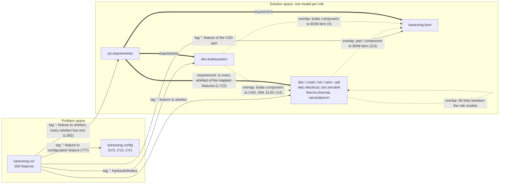
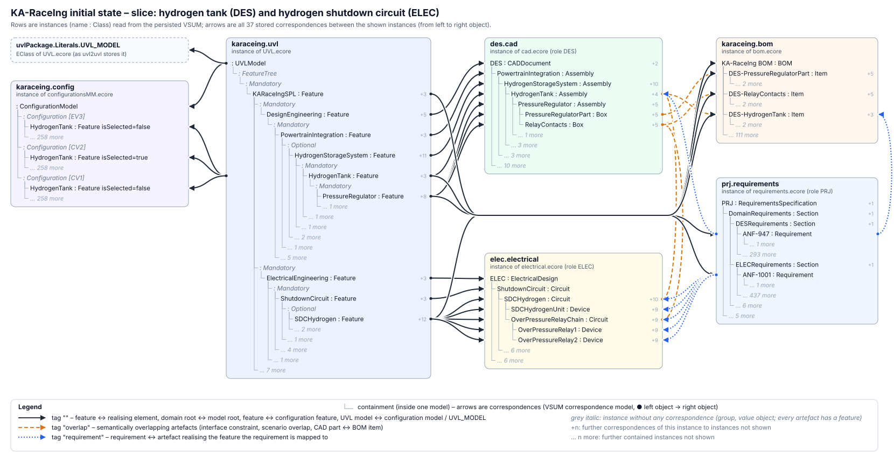

# Initial state of the KA-RaceIng VSUM – design rationale

This document explains how the initial state in `vsum/src/test/resources/initialstate` was built:
- which instances of the metamodels it contains;
- how these instances are linked by correspondences;
- why each decision was taken and which alternatives were considered.

It complements `KARACEING.md`, which covers the overall setup, the reactions and the tests.

All numbers below were taken from the persisted files themselves. The initial state is generated by
`karaceing-generator/initstate.py`; regenerating it reproduces the same files (only the line order of
`vsum/uuid.uuid` may differ).

---

## 1. Sources

| Input | Used for |
|---|---|
| `SPL_FeatureModels_v2_Stakeholders/models/*.uvl` (9 role models + composition `KARaceIngSPL.uvl`) | feature tree, typed features, the 113 cross-tree constraints |
| `SPL_FeatureModels_v2_Stakeholders/mapping/*_mapping.csv` | the 1,068 survey items (requirements, goals, functions) and the features they are mapped to |
| `SPL_FeatureModels_v2_Stakeholders/configurations/*.json` | the decisions of EV3, CV2 and CV1 (incl. the example completion of open design choices) |
| `EvolutionScenarios/concrete_scenarios.tex` (51 instances) | the scenario-specific artefacts and overlaps |
| *Inconsistency Scenarios* TechReport, KA-RaceIng section (KA-RaceIng-1 to -10) | the brake, pedal, scatter-shield and tyre artefacts, the overlap kinds K1–K11 and the attribute-level rules (section 6a, `REPORT_SCENARIOS.md`) |
| the metamodels in `model/src/main/ecore` | the classes the instances are made of |

Nothing in the initial state is invented freely. Every element is either:
1. derived from the feature model, the mapping or the configurations, or
2. required by a concrete evolution scenario (section 6) or by a scenario of the TechReport (section 6a).

Values the report scenarios need (dimensions, materials, suppliers, temperature limits, tyre parameters) are
plausible Formula Student values; they are not measured data of the team.

---

## 2. Guiding principles

**P1 – The initial state is what the VSUM would contain if the product line had been built through the reactions.**
The correspondences use the same kind, direction and tag as the template's reactions create them:
- `RootFeatureToX` / `FeatureToX` link (feature, element);
- `feature2config` links (UVL model, configuration model) and (feature, configuration feature);
- `uvl2uvl` links (UVL model, `uvlPackage.Literals.UVL_MODEL`).

Because of this, all reactions, including the reused Feature CPR pattern, work on the initial state
without special cases.

*Alternative considered:* building the initial state by replaying the product line through the
reactions in a test setup. Rejected for three reasons:
- it needs hundreds of scripted dialogs;
- the initial state would depend on the reactions under test, so a bug in a reaction would also
  corrupt the starting point of every test;
- it is slow.

**P2 – Persisted in Vitruvius' own storage format.**
The folder is exactly what Vitruvius writes for a VSUM (compare `vsumexample/vsum`):
- the model files;
- `vsum/models.models`;
- `vsum/uuid.uuid`;
- `vsum/correspondences.correspondence`.

The tests open it with `VirtualModelBuilder…withStorageFolder(…).buildAndInitialize()`, like any saved
VSUM. No reaction runs while it is loaded.

*Alternative considered (and rejected by Fabian):* a CSV list of correspondences that a test turns into
correspondences at start-up. That is not a VSUM artefact, and it hides the initial state behind test code.

**P3 – The provided metamodels are used as they are.**
- `UVL.ecore` and `configurationsMM.ecore` are unchanged.
- `cad.ecore` only has `Object` renamed to `DocumentObject` (approved). The name `Object` clashes with
  `java.lang.Object` in the generated code.
- What a provided metamodel cannot express is left out, and the gap is documented (section 7).

**P4 – One model per stakeholder role.**
Each of the 9 roles owns one model of its artefact type. The four CAD roles (DES, CRASH, KIN, AERO)
each get their own CAD document, not a shared one. This has two reasons:
- In the scenarios, a change by one role has to be propagated to the other roles. That is only
  visible when each role has its own artefact.
- The Feature CPR pattern maps one domain root feature to one model root.

**P5 – Every feature is realised in the model of its own role, and the containment hierarchy mirrors the feature tree.**
The pattern finds the container for a new element through the correspondence of the *parent* feature:
- `retrieve … corresponding to feature.eContainer().eContainer()` for nested features;
- `retrieve … corresponding to getDomainRootFeature(…)` for children of the domain root.

So every feature has one main realising element, placed below the realisation of its parent feature.
Further artefacts can correspond to the same feature (P6). The FCPR then uses the outermost of them,
the main realisation, as the container for the realisation of a new child feature.

**P6 – Every artefact corresponds to a feature (Fabian's rule, 2026-10-25).**
There is no artefact without a feature. Artefacts are all elements of the solution-space models that
represent something: parts, assemblies, sketches, circuits, devices, blocks, subsystems, thermal
elements, test suites and cases, instruments, sections, requirements, BOM items and brake components.
Value objects inside them are exempt: geometry, constraints, parameters, test steps, materials, car
values and BOM item types.

Elements that are not the main realisation of a feature get the feature of their containing element:
- the generated details below each leaf, e.g. the CAD `Box` `<Name>Part`, the ELEC `Device` `<Name>Unit`
  and the SIM `Block` `<Name>Logic`;
- the scenario-specific artefacts, e.g. `CarPC`, `RelayContacts` and `HydrogenConversionParts`;
- the role sections of the requirements specification and the test instruments.

Three kinds of element get their features from elsewhere:
- each requirement gets the features it is mapped to in the mapping;
- BOM items and brake components get the feature of the CAD element they overlap with;
- the BOM root gets the root feature, and the brake-system root gets `HydraulicBrakes`.

The leaf details still serve their other purposes: for CAD they are the physical parts the BOM items
refer to, and they make the models look like real artefacts, not copies of the feature tree.

Consequences for the reactions:
- **FCPR fix.** A feature can now be realised by several elements of one model, which the reused pattern
  did not handle: it stopped with "Multiple corresponding EClasses". With several candidates, the
  decision routine now takes the outermost one (the others are contained in it) and asks only if that is
  ambiguous. It passes this element to the create and map routines instead of retrieving the container
  again. The rest of the pattern is unchanged.
- **Reverse FCPRs.** These now cover every artefact class, including requirements, BOM items and brake
  components. A new artefact is mapped to:
  - the feature of its containing element (offered first);
  - the features of an element it overlaps with;
  - another existing feature;
  - or a new feature.

  There is no "no feature" option.
- **Feature removal.** "Keep artefact without feature" is gone. An artefact that still realises another
  feature keeps that feature; otherwise it is deleted or mapped to the parent feature.
- **Tests.** `InitialStateTest.everyArtefactCorrespondsToAFeature` checks the rule on the initial state.
  The test base checks it again after every scenario test, i.e. after every evolution step.

**P7 – Names are unique per model and are taken from the feature names.**
Every element realising a feature carries the feature's name; the FCPR pattern also names created
elements after their feature. This makes the correspondences readable. The tests, dialogs and
scenario descriptions also refer to elements by name. The generator enforces uniqueness per file.

There is one deliberate exception: `des.TankSystemIntegration` is realised by `CV1ChassisAdapterFrame`.
The scenarios 4.1-B, 4.3-A, 4.4-A and 6.4-A need an artefact with an artefact-specific name.

**P8 – Overlaps come from the data, the evolution scenarios and the TechReport; each has a kind.**
Semantic overlaps between roles come from three sources (section 5.2):
- the cross-role constraints of the feature model;
- the overlaps the concrete evolution scenarios explicitly need;
- the overlaps the KA-RaceIng scenarios of the TechReport need (element level, e.g. the CAD brake disc and
  the brake model block of the simulation).

Every overlap is classified into one of the kinds K1–K11 (`docs/OVERLAP_CATALOGUE.md`, generated). The kind
says what the two elements share (geometry and mass, mounting, supplier data, signals, …) and which
attribute-level rule propagates it (`KARaceIngOverlapRules`, rules AR1–AR13).

**P9 – Traces from requirements are kept apart from overlaps, and reach every artefact of the mapped features.**
A requirement and the artefact that realises it are not "the same thing in two models". They are a
trace, so they get their own tag `requirement`. A requirement traces to *every* artefact of the features it
is mapped to, in all solution-space models including the BOM and the brake specification (decision of
2026-10-26, option 1). Test cases additionally trace to the requirements they verify. The reverse FCPRs keep
this invariant: a new artefact gets the traces of its feature's requirements, a new requirement traces to all
artefacts of its feature.

**P10 – Derived values are consistent in the initial state.**
Values that the overlap rules derive are already derived in the initial state: the mass and material of every
BOM item are computed from the CAD geometry (same formulas as `KARaceIngOverlapRules`), the mass, inertia and
heat capacity of the simulated brake discs as well, and the signal parameters of the ABS and BOTS blocks mirror
the pins of the electrical devices. So a scenario test sees only the differences its own change causes.

---

## 3. Feature model and configurations

### 3.1 `karaceing.uvl` (`UVL.ecore`, unchanged)

| Content | Count |
|---|---|
| Features | 259 (258 role features + the composition root `KARaceIngSPL`) |
| Groups | 62 `Mandatory`, 47 `Optional`, 18 `Alternative` |
| Typed features (`Feature.attribute` = `Integer`) | 7 (e.g. `MaxVehicleMass`, `ScatterShieldMinThickness`) |
| Cross-tree constraints | 0 stored (113 in the role models, see 7.1) |

**Structure:**
- `UVLModel.tree.root` is a `Mandatory` group with the single feature `KARaceIngSPL`.
- Below it there is **one `Mandatory` group per domain root**, 9 in total: `ProjectAndRequirements`,
  `DesignEngineering`, `CrashStructure`, `Kinematics`, `Aerodynamics`, `Thermodynamics`,
  `ElectricalEngineering`, `Simulation`, `Validation`.
- Below each domain root, the role's feature tree is copied exactly, keeping group kinds and order.

**Why one group per domain root:** the pattern's `FeatureTreeUtil` finds a domain root as "the first
feature of a group below the root feature" (`getRootFeatureOfDomain`, `isRootFeatureWithoutDomainRoot`),
and `RootFeatureToX` triggers on a feature with the domain root's name directly below the root.
Putting all nine domain roots into one group would hide all but the first.

### 3.2 `karaceing.config` (`configurationsMM.ecore`, unchanged)

| Configuration | Index | Features | Selected |
|---|---|---|---|
| EV3 (25e) | 0 | 259 | 177 |
| CV2 (25h, hydrogen) | 1 | 259 | 162 |
| CV1 (19c, petrol) | 2 | 259 | 133 |

**Contents:**
- Each configuration contains *every* feature as a configuration `Feature` (`name`, `isSelected`), in
  the order of the feature tree, with `PLVersion = 1`. This is the state `feature2config` produces,
  since it adds every new feature to every configuration.
- Open design decisions are completed with the example completion from the configuration files, so
  each configuration is a complete product.
- Before writing, the generator checked each configuration against the group semantics and all
  113 constraints; all three are valid products.
- Configurations have no name attribute, so EV3, CV2 and CV1 are identified by their index.

---

## 4. Domain models (instances of the role metamodels)

### 4.1 Overview

| Role | Metamodel | File | Elements* | Mapping feature → element |
|---|---|---|---|---|
| PRJ | `requirements.ecore` (new) | `prj.requirements` | 3,023 | feature → `Section`; survey items → `Requirement` (+ `CarValue` per car) |
| DES | `cad.ecore` | `des.cad` | 177 | feature → `Assembly`; leaf → `Box` part; typed feature → `Sketch` |
| CRASH | `cad.ecore` | `crash.cad` | 61 | as DES |
| KIN | `cad.ecore` | `kin.cad` | 25 | as DES |
| AERO | `cad.ecore` | `aero.cad` | 22 | as DES |
| THERMO | `thermal.ecore` (new) | `thermo.thermal` | 36 | feature → `ThermalSystem`; leaf → element by kind; typed → `ThermalProtection` |
| ELEC | `electrical.ecore` (new) | `elec.electrical` | 110 | feature → `Circuit`; leaf → `Device` |
| SIM | `simuLink.ecore` | `sim.simulink` | 87 | feature → `SubSystem`; leaf → `Block` |
| VAL | `testbench.ecore` (new) | `val.testbench` | 43 | inner feature → `TestSuite`; leaf → `TestCase` with 2 `TestStep`s |
| – | `bom.ecore` | `karaceing.bom` | 369 | one `Item` per physical CAD part, plus purchased brake parts and electrical components |
| – | `brakesystem.ecore` | `des.brakesystem` | 10 | brake specification: discs, calipers with pads, ABS sensors, hose |

\* All model elements including the root and contained value objects. All 13 models together have
5,139 elements, which is the number of lines in `vsum/uuid.uuid`. The report scenarios added 179 of them
(section 6a).

The model root of each role is named after the role (`DES`, `ELEC`, …). Its container class is the
metamodel's root class (`CADDocument`, `ElectricalDesign`, `SimulinkModel`, `ThermalAnalysisModel`,
`TestBenchConfiguration`, `RequirementsSpecification`).

### 4.2 Why these metamodels

**CAD (DES, CRASH, KIN, AERO):** the CAD metamodel provided in the template is based on FreeCAD
(`CADDocument`, `Assembly`, `Sketch`, `Box`, …).
- `Assembly` can contain any `DocumentObject`, so the feature tree can be mirrored without restrictions.
- Each document gets three materials (Steel, Aluminium, CFRP); parts use Steel. DES additionally has
  Titanium and StainlessSteel for the brake parts and the brake pedal.

**SIM:** `simuLink.ecore` is used as it is.
- `SubSystem.subBlocks` allows nesting, so inner features become `SubSystem`s.
- Leaves get a `Block` `<Name>Logic` with a `SampleTime` parameter.

**PRJ, THERMO, ELEC, VAL – new, deliberately lightweight metamodels.** No metamodel existed for these
artefacts, and the case study needs them to be domain models, not generic containers. All four follow
the same shape: a root class, a container class that can nest (`Section`, `ThermalSystem`, `Circuit`,
`TestSuite`), and typed leaf classes. That shape is what the FCPR pattern relies on:
- `EMFUtil.findContainedClasses` offers the leaf classes;
- `getAllContainedEObjects` offers the existing elements.

Each also has the attributes the scenarios talk about:
- requirements: `text`, `kind`, `role`, the values per car and `allowedValues` (values a requirement
  permits, e.g. the brake pedal materials of ANF-217; report scenario R4);
- ELEC: `voltageClass` / `nominalVoltage` (HV 600 V vs LV 24 V), `DeviceKind`, `partNumber`, pins with
  signals and `mountingPosition` (the name of the CAD element a device is mounted on; R2);
- THERMO: `temperatureResistance` and the class `ThermalComponent` (material, supplier, thermal
  conductivity, specific heat capacity, temperature limit; the supplier data sheet of a part, R3);
- VAL: `procedure`, `passCriterion`, steps with `expectedResult` and `verifiedRequirements`.

The three additions for the report (`Requirement.allowedValues`, `Device.mountingPosition`,
`ThermalComponent`) are the only metamodel changes; they are in the new metamodels, the provided ones are
unchanged.

*Alternative considered for ELEC:* `sysML.ecore`. It is a full SysML v2 metamodel without a simple
containment tree, and the generic `EMFUtil` functions of the pattern do not work on it. This is
still an open question (`KARACEING.md`).

### 4.3 Mapping rules per metamodel

**CAD:**
- every non-typed feature → `Assembly` with the feature's name, nested like the feature tree;
- every leaf feature → additionally a `Box` `<Name>Part` (0.1 × 0.05 × 0.02 m, Steel);
- every typed feature → a `Sketch` with one `LineSegment` and a `Distance` constraint whose value is
  the feature's value (first car that has one).

**ELEC:**
- every feature → `Circuit`; features below `HighVoltage` get `voltageClass = HV` (600 V), all others
  `LV` (24 V);
- every leaf → additionally a `Device` `<Name>Unit`, whose `DeviceKind` is derived from the name
  (Relay, Sensor, Switch, Indicator, Battery, Connector, Motor, ControlUnit, …).

**SIM:** every feature → `SubSystem` (`tag` = feature name); every leaf → additionally a `Block`
`<Name>Logic`.

**THERMO:**
- every feature → `ThermalSystem`;
- every leaf → a `HeatExchanger`, `HeatSource`, `ThermalProtection`, `FluidLine` or `AnalysisCase`,
  chosen by name;
- the typed feature `MinTemperatureResistance` → `ThermalProtection` with that value.

**VAL:**
- inner features → `TestSuite`;
- leaf features → `TestCase` with a procedure, a pass criterion and two steps (`…Setup`, `…Execution`);
- the configuration holds five `Instrument`s (stopwatch, tilt platform, sound level meter, isolation
  tester, brake deceleration).

**PRJ:**
- every PRJ feature → `Section` (nested like the feature tree);
- each of the 1,068 survey items becomes a `Requirement`: `name` = item ID, short text, subteam,
  category, unit, priority, role, kind (requirement / goal / function), and one `CarValue` per car
  in which the item has a value (1,925 in total);
- the 15 items mapped to PRJ features are placed in the section of their feature;
- the other 1,053 are placed in `DomainRequirements/<ROLE>Requirements`, one section per role.

So the requirements specification contains *all* requirements of the line, which is what the
Requirements Engineer owns.

### 4.4 BOM and brake system

**BOM** (the procurement data and supplier data sheets of the report):
- 5 `ItemType`s (Part, Assembly, PurchasedPart, Fastener, ElectricalComponent), each with the
  parameter definitions `mass`, `material`, `supplier`, `specification` and `partNumber`;
- 109 `Item`s:
  - one per CAD `Box` (part), with id `<ROLE>-<name>`;
  - `DES-HydrogenTank` (PurchasedPart, CFRP), `DES-CriticalBracingBolts` (Fastener, 8 pieces),
    `ELEC-OldInverter` (ElectricalComponent);
  - the brake parts of the report: `DES-Front/RearBrakeDisc` (purchased, supplier, specification
    `solid`), `DES-Front/RearBrakeCaliper` (assembly, specification `monobloc`),
    `DES-Front/RearCaliperPiston` (purchased titanium pistons of `PistonSupplier A`), `DES-FrontBrakeHose`;
  - the electrical brake components: caliper temperature sensors, wheel speed sensors, `ELEC-ABSControlUnit`,
    `ELEC-BOTSSwitch` (with part numbers).

Mass and material of an item are derived from the CAD geometry (P10). Only physical things get a BOM item;
sketches and software do not.

**Brake system** (the *Brake Specification Model* of the report): the existing `brakesystem.ecore` of the
template, with 2 disks (not ventilated, 4 mm, minimum 3 mm), 2 calipers (`monobloc`) with one pad set each
(8 mm), 2 ABS wheel speed sensors and 1 hose. Each component overlaps the CAD element it specifies (element
level: `FrontBrakeDisk` ↔ CAD `FrontBrakeDisc`, …) and, where the report needs it, the BOM item and the SIM
block; the specification root overlaps the DES assembly `HydraulicBrakes`.

---

## 5. Correspondences (`vsum/correspondences.correspondence`)

All 5,400 correspondences are `ReactionsCorrespondence`s (the class the Reactions runtime creates),
with one left and one right object. The hrefs are relative to the `vsum` folder
(`../des.cad#//@objects.3/@children.1`). Left/right are always written as the reactions would write
them: feature left, artefact right.



### 5.0 Instances and correspondences in one picture

The overview above aggregates the links per model. The diagram below shows a real slice of the
initial state on the level of instances: the hydrogen tank of DES and the hydrogen shutdown circuit
of ELEC. Each row is an instance (`name : Class`) and each arrow is one stored correspondence between two
shown instances, drawn from its left to its right object. The diagram is generated from the persisted
files by `karaceing-generator/diagrams/slice_svg.py`, so nothing in it is drawn by hand.



How to read it:
- **Thin grey tree lines** show containment: which instance contains which inside one model. This is not a
  correspondence.
- **Haloed lines with a dot and an arrowhead** are correspondences from the VSUM correspondence model. The
  dot marks the left object and the arrowhead the right object of the stored correspondence. The colour and
  line style give the tag.
- **Black arrows (tag `""`)** come in four kinds:
  - each feature to the element realising it (`HydrogenTank : Feature` to `HydrogenTank : Assembly`);
  - the domain roots to the model roots (`DesignEngineering` to `DES : CADDocument`);
  - `HydrogenTank` to its configuration feature in each of EV3, CV2, CV1 (selected only in CV2);
  - the UVL model to the configuration model and to `UVL_MODEL`.
- **Orange arrows (`overlap`)** come in three kinds:
  - the interface constraint `elec.SDCHydrogen => des.HydrogenTank` (circuit to assembly);
  - the scenario overlap of 6.1-B (`RelayContacts : Box` to `OverPressureRelayChain : Circuit`);
  - three CAD parts to their BOM items.
- **Blue arrows (`requirement`)**: ANF-947 to the tank assembly and ANF-1001 to the shutdown circuit.
- **Black arrows from details:** elements that are not a main realisation correspond to the feature of
  their containing element (principle P6). Examples are `PressureRegulatorPart` and `RelayContacts` to
  `PressureRegulator`, and `SDCHydrogenUnit` and the over-pressure relays to `SDCHydrogen`. The BOM items
  correspond to the feature of their CAD part, and the requirements ANF-947 and ANF-1001 to the features
  they are mapped to.
- **Grey italic rows** have no correspondence at all: only groups and value objects, which are not
  artefacts.
- **`+n`** counts the further correspondences of an instance to instances outside the slice, and
  **`… n more`** counts the contained instances that are not shown.

**All instances.** `docs/initial_state_explorer.html` opens in any browser and shows every instance
and correspondence. It has a model map (instances per model by class, links between models with
counts) and a browser with search. For any selected instance it draws the same kind of diagram as
above.

**How the scenarios change the state.** At the bottom, the explorer has a section *Evolution scenarios*. It lists all
51 concrete scenarios; scenarios 2 and 5 are shown as not executable (constraints via VitruvOCL). For each
of the 36 executed scenarios it shows:
- the description from the test;
- the number of added and removed instances and correspondences;
- a diagram of the affected instances per model: added, removed (struck through), changed or moved, with
  the added and removed correspondences as arrows. Existing instances that only gain or lose a
  correspondence are marked as re-linked (⇄), e.g. the existing feature `AntiIntrusionPlate` to which the
  new lidar bracket of 3.1-B is mapped. A badge counts the correspondences each instance gained or lost;
- hovering an instance in the diagram shows only its correspondences and outlines the instances at
  their other ends; a click pins this view, a double-click opens the instance in the explorer (the
  correspondence diagram of the initial state works the same way);
- a table of all added and removed correspondences, with tag, both ends, and whether each end is new,
  existing or removed;
- the propagation log: what the modeller changed, what the reactions changed in which model, which
  correspondences each propagation added or removed, and which dialog was answered how.

All of this is recorded from real test runs. With the system property `karaceing.snapshotDir`, every
scenario test copies the VSUM state it leaves behind into `<dir>/<TestClass>.<method>`. It also writes
`propagation.json` with every change propagation: the original and consequential atomic changes and the
dialogs, taken from a Vitruvius `ChangePropagationListener`. Correspondences are not atomic changes. The
listener therefore reads the persisted correspondence model when a propagation starts and when it ends:
Vitruvius saves the VSUM in between. It resolves both against the models in memory and records the
difference. For all 36 scenarios the correspondences recorded per propagation add up to exactly the
difference between the final snapshot and the initial state.

`karaceing-generator/diagrams/states.py` compares each snapshot with the initial state. Instances are
matched by the UUID that Vitruvius keeps for them in `vsum/uuid.uuid`, so moved instances and shifted
indices are recognised. As a check, the snapshots of `InitialStateTest`, which changes nothing, give an
empty diff.

Without the property the tests behave as before.

Regenerate the diagrams after changing the initial state, the reactions or the tests:

```
./mvnw verify -pl vsum -am -Dtest='InitialStateTest,Scenario*Test' -Dsurefire.failIfNoSpecifiedTests=false \
      -Dkaraceing.snapshotDir=$PWD/vsum/target/snapshots
python3 karaceing-generator/diagrams/extract.py
python3 karaceing-generator/diagrams/scenarios.py vsum/target/snapshots
python3 karaceing-generator/diagrams/slice_svg.py
python3 karaceing-generator/diagrams/build_explorer.py
```

### 5.1 Tag `""` – structural correspondences (2,461)

| Kind | Left → right | Count | Created like / used by |
|---|---|---|---|
| Domain root ↔ model root | `Feature` (domain root) → role model root | 9 | `RootFeatureToX`; the FCPRs retrieve the root container via the domain root |
| Feature ↔ realising element | `Feature` → `Assembly` / `Sketch` / `Circuit` / `SubSystem` / `ThermalSystem` / `TestSuite` / `TestCase` / `Section` / … | 252 | `FeatureToX` (`addCorrespondenceBetween(feature, element)`); FCPRs, feature removal, reverse CPRs |
| Feature ↔ further artefact (P6) | feature of the containing element → `…Part`, `…Unit`, `…Logic`, scenario and report artefacts, role sections, instruments | 224 | reverse FCPR ("Feature of the containing element"); feature removal |
| Feature ↔ requirement | mapped feature(s) → `Requirement` (up to 3 per requirement) | 1,077 | reverse FCPR of the requirements specification; feature removal |
| Feature ↔ BOM item / brake component | feature of the overlapping CAD element (electrical components: of the device) → `Item` / `BrakeComponent`; root feature → BOM; `HydraulicBrakes` → brake system | 120 | reverse FCPRs of the BOM and the brake system |
| UVL model ↔ configuration model | `UVLModel` → `ConfigurationModel` | 1 | `feature2config` (retrieves the configuration model via the UVL model) |
| Feature ↔ configuration feature | `Feature` → configuration `Feature` (×3 cars) | 777 | `feature2config`; the removal ConfigCPR finds the configuration features of a removed feature this way |
| UVL model ↔ `UVL_MODEL` literal | `UVLModel` → `uvlPackage.Literals.UVL_MODEL` | 1 | `uvl2uvl` |

The 251 realisation correspondences break down as DES 88, ELEC 51, CRASH 34, PRJ 20, SIM 17,
THERMO 17, KIN 9, VAL 9 and AERO 6. Three features have a second realising element because a scenario
needs it:
- `crash.MainHoop` → `LidarBracket`;
- `elec.BrakeSystemPlausibilityDevice` → `BSPDTestConnector`.

`kin.KinematicsForTyreModel` is realised *only* by the sketch `KinematicsTables` below `Suspension`
(scenario 6.2-A removes that sketch).

Every artefact has at least one of these correspondences (rule P6). For 157 combinations of feature and
model there is more than one artefact; the FCPR uses the outermost one as the main realisation.

Overlap and trace links never touch a feature. So everything the FCPRs retrieve for a feature is its
realisation or its configuration features, and the pattern filters the latter out by metamodel.

### 5.2 Tag `"overlap"` – semantically overlapping artefacts (217)

| Source | Count | Rationale |
|---|---|---|
| Cross-role constraints | 36 | Each constraint of the composition that connects features of two different (non-PRJ) roles is an interface between them. Examples: `elec.Accumulator => des.AccumulatorContainer`, `sim.ElectronicThrottleControl <=> des.ElectronicThrottleBody`. The main realisations of the two features overlap. 32 constraints span several roles and yield 36 distinct pairs. PRJ is excluded because its variant drivers (Powertrain, RuleSet, …) constrain almost everything and would connect every artefact with every other. |
| Evolution scenario overlaps | 18 | Overlaps a concrete evolution scenario needs, e.g. `crash.LidarBracket` ↔ `sim.LidarPoseMainHoop` (6.1-A), `elec.OldInverter` ↔ `sim.OldInverterInterface` (6.2-B), `thermo.WaterInjection` ↔ `des.IntakeSystem` (3.2-B/C). Full list: `EXTRA_OVERLAP` in `initstate.py`. |
| Physical parts ↔ BOM items | 109 | Every physical part in a CAD model (and every electrical component that is ordered) is the same thing as its BOM item. |
| Report scenario overlaps | 54 | Element-level overlaps the KA-RaceIng scenarios of the TechReport need (`REPORT_OVERLAP` in `initstate.py`), e.g. CAD `FrontBrakeDisc` ↔ SIM `FrontBrakeDiscModel` (R1), BOM `DES-FrontCaliperPiston` ↔ THERMO `FrontCaliperPistonThermalModel` (R3), CAD `FrontCaliperMountingBracket` ↔ ELEC `FrontCaliperTemperatureSensor` (R2), ELEC `ABSControlUnit` ↔ SIM `ABSControl` (R6), KIN `DryTyres` ↔ SIM `DryTyreParameterSet` (R8). They replace the five coarse links of the brake components to `HydraulicBrakes`. |

**Kinds.** Every overlap has one of the kinds K1–K11, either given with the report overlap or derived from the
pair of models it connects (CAD↔SIM is K1, CAD↔BOM is K4, anything with the brake specification is K5, …):

| Kind | Overlap | Count |
|---|---|---|
| K1 | CAD geometry / mass → SIM parameters | 12 |
| K2 | CAD ↔ THERMO thermal model | 13 |
| K3 | CAD ↔ ELEC mounting / packaging | 17 |
| K4 | CAD part ↔ BOM item | 102 |
| K5 | brake specification ↔ CAD / BOM / SIM / ELEC | 18 |
| K6 | BOM supplier / material data ↔ THERMO | 2 |
| K7 | artefact ↔ validation (test cases, limits) | 19 |
| K8 | ELEC signals ↔ SIM control model | 16 |
| K9 | CAD ↔ CAD across roles (shared space, mass) | 8 |
| K10 | KIN tyres ↔ SIM tyre parameter sets | 3 |
| K11 | ELEC component ↔ BOM item | 7 |

`docs/OVERLAP_CATALOGUE.md` lists every overlap with its kind, its source, the justification and the scenario
tests that name one of its elements; it is generated together with the initial state.

Overlaps are stored once per pair (duplicates are removed) and link *artefacts*, never features.
They are used by the `Overlap<Src>To<Tgt>` reactions on two levels:
- **element level:** a new element below an artefact with overlaps triggers a counterpart in the other model
  (created, linked or ignored); removing an artefact asks what to do with its counterparts;
- **attribute level:** an attribute or structure change of an artefact, or of an element below it, is propagated
  to the counterparts by the rules AR1–AR13 (`KARaceIngOverlapRules`): derived values are written (mass,
  material, specification, signals, part numbers, thermal data, expected results), everything else is notified
  to the owner of the counterpart. See `REPORT_SCENARIOS.md`.

### 5.3 Tag `"requirement"` – requirement traces (2,722)

A requirement traces to every artefact of the features it is mapped to (P9), and every test case to the
requirements it verifies. By model: ELEC 918, DES 659, BOM 472, CRASH 221, SIM 146, THERMO 120, brake
specification 98, KIN 36, AERO 30, VAL 22.
- 1,053 of the 1,068 requirements have at least one trace.
- The 15 requirements mapped only to PRJ features are traced by containment instead, because they
  sit in the section that realises their feature.

*Why requirement → artefact and not requirement → feature:* the trace from a requirement to a
feature already exists in the mapping, and the artefacts are reached from there. The link that
matters for consistency is the one to the artefact: when that artefact is removed, the requirements that no
other artefact of that model realises are reported as violated (rule AR10, report scenario R5), and the trace is
removed. When the values a requirement allows change, the traced artefacts are checked (AR8/AR9, R4). A
dedicated tag keeps these links out of the overlap propagation.

*Why every artefact and not only the main realisation (changed on 2026-10-26):* the report scenarios need the
requirement at the BOM item (R4: the ordered pedal violates the material requirement), at the brake
specification (R7: wear and maintenance requirements) and at the parts below the main realisation (R5: the
scatter-shield variants). Tracing only the main realisation (the earlier option 2) would miss all three.

---

## 6. Scenario-specific artefacts

These elements are not derived from the feature model. They are what the concrete scenarios assume
to exist before the evolution step (`EXTRA` and `LEAF_CONTENT` in `initstate.py`).

| Artefact (model) | Needed by | Purpose |
|---|---|---|
| `CellFixationSketch` (DES, in `AccumulatorContainer`) | 1.1-C | existing sketch the new feature is mapped to |
| `ReliefValveAndFlameArrestor` (DES) + `BackfireReliefAnalysis` (THERMO) | 4.2-A, 6.3-A | realisation of backfire protection in both domains |
| `CriticalBracingBolts` (DES) + `LugJoints`, `SleeveJoints` (CRASH) | 4.2-B | fasteners of the mechanically attached bracing |
| `HydrogenConversionParts` with `AdaptedCylinderHead`, `InjectorAdapters` (DES) + `EngineConversionAnalysis` (THERMO) | 4.3-A, 6.4-A | conversion parts of the hydrogen engine |
| `CV1ChassisAdapterFrame` (DES, realises `TankSystemIntegration`) | 4.1-B, 4.3-A, 4.4-A, 6.4-A | realisation with an artefact-specific name |
| `RelayContacts` (DES) + `OverPressureRelayChain` with 2 relays (ELEC) | 6.1-B | over-pressure shutdown in CAD and electrics |
| `LidarBracket` (CRASH) + `LidarPoseMainHoop` (SIM) | 6.1-A | lidar mount and its pose in the AS software |
| `KinematicsTables` (KIN) + `VDCSimulinkModel`, `VDCParameterSet` (SIM) | 6.2-A | kinematics data used by the vehicle dynamics control |
| `CarPC`, `ROS1BridgePort` (ELEC) + `ROS1StateMachineNode`, `ROS1StatusNode` (SIM) | 3.1-B/C, 3.3-A, 6.1-B/C | AS compute unit and ROS 1 interfaces |
| `PlugDetectionCircuit` (ELEC) + `PlugDetectionSignal` (SIM) | 6.1-D | TS plug detection in electrics and software |
| `OldInverter` (ELEC) + `OldInverterInterface`, `OldInverterRegenInterface` (SIM) | 6.2-B | inverter that is replaced |
| `BSPDTestConnector` (ELEC) + `BSPDSignalInjectionTest` (VAL) | 6.2-C | BSPD test access and its test case |
| `CellTemperatureDerating` (SIM) | 1.2-C | software counterpart of the cell temperature monitoring |

---

## 6a. Artefacts of the TechReport scenarios

The KA-RaceIng scenarios of the *Inconsistency Scenarios* TechReport are mapped onto the existing models; the
feature model is unchanged. All artefacts get features by P6 (containing element; the BOTS switch realises
`des.BrakeOverTravelSwitch`).

| Artefact (model) | Report scenario | Purpose |
|---|---|---|
| `Front/RearBrakeDisc` assemblies with a solid `…BrakeDiscBody` cylinder (DES, below `HydraulicBrakes`) | R1, R7 | the disc that becomes vented |
| `Front/RearBrakeCaliper` with `…CaliperBody` (monobloc housing), `…CaliperPiston` (titanium), `…CaliperMountingBracket`, `…BrakePads`; `FrontBrakeHose` (DES) | R2, R3, R7 | caliper that becomes two-piece; piston of the supplier change; mounting interface of the sensor |
| `BrakePedalPart` material Titanium (DES), `ANF-217.allowedValues` = Steel, Aluminium, Titanium (PRJ) | R4 | the ordered pedal that becomes non-compliant |
| brake specification: disks, calipers with pads, ABS sensors, hose (`des.brakesystem`) | R1, R2, R6, R7 | *Brake Specification Model* |
| BOM items for discs, calipers, pistons, hose, sensors, ABS unit, BOTS switch with supplier, specification, part number | R1–R4, R6 | procurement / supplier data |
| `BrakeSystemModel` (disc and pad models with derived parameters, `ABSControl`, `BOTSSwitchLogic` with signal parameters) and `TyreModel` (`Dry/WetTyreParameterSet`) below `VehicleDynamicsControl` (SIM) | R1, R6–R9 | brake and tyre models of the simulation |
| `BrakeSensors` circuit (caliper temperature sensors, wheel speed sensors, `ABSControlUnit`) and `BOTSSwitch` in the shutdown circuit (ELEC) | R2, R6, R9 | *SysML architecture* / electrical design |
| `BrakeThermalManagement` with `Front/RearCaliperPistonThermalModel` (`ThermalComponent`), disc heat sources and `CaliperPistonTemperatureAnalysis` (THERMO) | R1, R3 | thermal analysis with supplier material data |
| `BrakeValidation` suite: `BrakeAssemblyBuild`, `CaliperPistonTemperatureTest`, `BrakeDiscSimulationCorrelation`, `BrakePedalMaterialCompliance`, `ScatterShieldCompliance`, `BrakeOverTravelSwitchTest` (VAL) | R1–R5, R9 | validation test configuration |
| `WheelAndBrakeFlowRegion` (AERO) | R1 | the region in which venting changes the airflow (FT-08) |

Not represented: the Wiki model, performance analysis reports, the inventory / order model and the CAD tool
itself (R10). Steps of the report on these artefacts are documented in `REPORT_SCENARIOS.md`, not executed.

---

## 7. What is deliberately not in the initial state

1. **Cross-tree constraints.** The provided UVL metamodel has constraint classes, but it cannot store a
   real constraint:
   - `Reference` / `TermReference` cannot point to a `Feature`;
   - `Constant` has no value;
   - `Negation` / `ParenthesisConst` have no operand;
   - the operands of `BinaryConst` / `Predicate` are non-containment.

   The 113 constraints are therefore used only to check the configurations during generation and to
   derive the overlaps (5.2). They will be added later as VitruvOCL constraints (scenarios 2 and 5).
2. **Feature values per car.** Configuration features have only `name` and `isSelected`. The value
   of a typed feature is stored in the artefact (CAD sketch constraint, thermal `temperatureResistance`)
   with one value, the first car's.
3. **Abstract features and cardinalities.** These are not represented; all features are concrete.
4. **SysML.** It is not used (see 4.2).

---

## 8. Persistence details and checks

**`vsum/models.models`** lists the 13 model URIs. **`vsum/uuid.uuid`** has one line
`ord__<id>|<model URI>#/0/<path>` per element (5,139 lines):
- the ids are deterministic (hash of the hierarchical id), so regenerating produces the same ids;
- Vitruvius stores absolute URIs in both files, so they contain the placeholder
  `file:/KARACEING_INITIAL_STATE`.

**Loading.** `InitialStateLoader` copies the folder into the test's `@TempDir`, replaces the
placeholder with the real folder URI, and builds the VSUM on it. Each test class does this explicitly
in its `@BeforeEach loadInitialState(...)`.

**Checks performed** (in addition to the rule check of P6, which `initstate.py` asserts as well):
- during generation:
  - names are unique per model;
  - every feature has a realisation;
  - all three configurations are valid against groups and constraints.
- after generation:
  - all 2,712 distinct correspondence hrefs resolve to an element;
  - all 5,139 uuid entries resolve and are unique;
  - regenerating yields identical model and correspondence files.
- in the VSUM: `InitialStateTest` checks that all models are loaded, that every feature is realised in
  its role's model, the configuration links, the overlaps and requirement traces, and the car
  decisions, and the rule of P6. All 6 tests pass in `mvn clean verify`.

**Regenerating:**

```
pip install pyecore
KARACEING_SPL=<path to SPL_FeatureModels_v2_Stakeholders> python3 karaceing-generator/initstate.py
```
